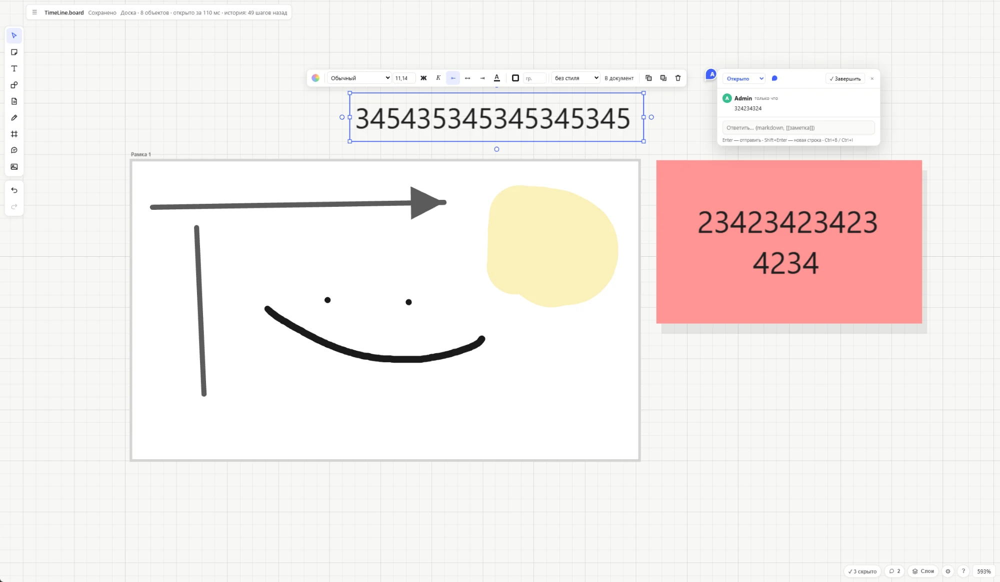

# vaultboard

Бесконечная доска в духе Miro, которая хранит всё обычными файлами у тебя на диске. Стикеры, фигуры, стрелки, рисование, фото без сжатия, карточки ссылок и видео, комментарии, слои — и markdown-заметки, которые открываются и правятся прямо на доске. С Obsidian дружит: можно указать его хранилище, и заметки на досках будут те же, что в Obsidian. Без Obsidian тоже работает.

*An open-source, local-first Miro-like whiteboard. Boards, notes and photos are plain files in a folder you choose. The interface is in Russian.*



## Установка

**Windows:** скачай установщик `vaultboard-setup-….exe` со [страницы последнего релиза](https://github.com/jestxfot/vaultboard/releases/latest) и запусти. Установщик спросит, куда ставить, и нужен ли ярлык на рабочем столе; права администратора не нужны (ставится в `%LOCALAPPDATA%\Programs\vaultboard`). Установщик не подписан, поэтому Windows может показать «Windows защитил ваш компьютер» — нажми «Подробнее» → «Выполнить в любом случае».

**Linux:** там же — `vaultboard-….AppImage` (запускается сам, без установки: `chmod +x` и двойной щелчок).

**iPad:** там же — `vaultboard-…-ipad.ipa`. Это то же приложение, только доски лежат на самом iPad, без компьютера (см. [«vaultboard на iPad»](#vaultboard-на-ipad)). В App Store его нет: файл ставится с компьютера и подписывается твоим Apple ID — бесплатного хватает.

1. На Windows поставь [Sideloadly](https://sideloadly.io), а для него — iTunes и iCloud с сайта Apple (не из Microsoft Store).
2. Подключи iPad кабелем, на iPad нажми «Доверять этому компьютеру».
3. Перетащи `.ipa` в Sideloadly, введи свой Apple ID и нажми Start.
4. На iPad: Настройки → Основные → VPN и управление устройством → твой Apple ID → «Доверять». На iPadOS 16 и новее ещё включи Настройки → Конфиденциальность и безопасность → Режим разработчика (iPad перезагрузится).

С бесплатным Apple ID подпись действует 7 дней — потом vaultboard не откроется, пока его не переподпишешь: снова Start в Sideloadly (или включи там автообновление по Wi-Fi). Доски при этом не пропадают. Новая версия ставится так же, поверх старой. Вместо Sideloadly подойдёт [AltStore](https://altstore.io): он переподписывает приложение сам, когда iPad и компьютер в одной сети Wi-Fi.

vaultboard открывается в своём окне. Сначала — первая настройка: где хранить доски (можно выбрать хранилище Obsidian или создать новую папку) и как подписывать тебя в комментариях. Потом это окно открывается щелчком по логотипу vaultboard слева вверху. После настройки сразу открывается готовая доска «Черновик» — она же открывается по умолчанию, когда открыть больше нечего; новые доски создаются кнопкой «+» слева.

У каждой доски может быть своё окно: Ctrl+щелчок (или средняя кнопка) по доске в списке слева, или правой кнопкой → «Открыть в новом окне». Одна доска открыта только в одном окне — если она уже открыта, vaultboard просто покажет то окно. Доску можно открыть и из любой другой папки: двойным щелчком по файлу `.board`, через Ctrl+O или «Открыть доску…» в меню значка в трее. Там же — «Недавние доски»; в Windows они есть и в меню значка на панели задач. Ctrl+N — ещё одно окно.

Закрыть окно — закрыть его; последнее окно прячется в трей: vaultboard продолжает работать, и гости по приглашению не отключаются. Открыть снова — щелчок по значку в трее или по ярлыку. Выйти совсем — правой кнопкой по значку → «Выйти». Папки (для досок, для сайта) выбираются обычным окном Windows.

## Обновления

Установленный vaultboard обновляется сам по [релизам на GitHub](https://github.com/jestxfot/vaultboard/releases): при запуске и раз в несколько часов он проверяет, нет ли новой версии, и скачивает её в фоне — только изменившиеся части, а не весь установщик заново. Когда версия скачана, сверху появляется плашка «Готова версия …»: «Перезапустить» поставит её сразу, иначе она поставится при выходе из vaultboard. То же — в меню значка в трее. Нет интернета — работает текущая версия. Запуск из исходников (`npm run app`) сам не обновляется.

Доски и заметки лежат в выбранной папке, а не в папке программы, настройки компьютера — отдельно, в `%LOCALAPPDATA%\vaultboard\settings.json` (на Linux — `~/.config/vaultboard`); удаление и переустановка их не трогают.

Если что-то не запустилось, vaultboard покажет окно с путём к логу (`%TEMP%\vaultboard.log`).

## Запуск из исходников (Windows, macOS, Linux)

Нужен [Node.js](https://nodejs.org) 22 или новее.

```bash
npm install
npm run app      # собрать и открыть в своём окне (Electron)
```

Без окна, в обычном браузере: `npm run build`, потом `npm start` — приложение будет на http://localhost:5180.

## Где что лежит

Всё, что ты делаешь, — обычные файлы в папке, которую выбрал при первой настройке:

```
Моя доска/
  доска.board        ← сама доска (JSON, по объекту на строку — удобно для git)
  .история.jsonl     ← история отмены: Ctrl+Z работает и после перезапуска
  фото/…             ← фото как есть, без сжатия
  ссылки/…           ← обложки и значки карточек ссылок
  Заметка.md         ← документы доски — обычный markdown
```

Папку доски можно перенести куда угодно целиком — фото, документы и история переедут вместе с ней.

## Что умеет

- **Доска:** левая кнопка по объекту — выделить и тащить, по пустому месту — рамка выделения; доску двигают правой кнопкой, средней или пробелом; колесо — зум. Щелчок правой — меню.
- **Объекты:** стикеры (N), текст (T), фигуры (R, O), рамки (F), стрелки и линии разных типов и толщин (L), документы-заметки (D), фото и файлы (Ctrl+V или перетащить).
- **Рисование:** ручка (P) с нажимом пера, выделитель (M), ластик (E), лассо; нарисованный от руки круг или прямоугольник становится фигурой.
- **Текст и стили:** markdown прямо в стикерах, шрифты (встроенные и системные), стили с массовой заменой.
- **Ссылки:** вставил адрес — карточка с обложкой и заголовком; видео YouTube и Vimeo играют прямо на доске.
- **Комментарии (C):** булавки со статусами, цветами и формами, ответы деревом, реакции, markdown и `[[ссылки]]` на заметки; «Скрыть завершённые».
- **Слои (Shift+L):** скрыть или закрепить целый слой, например все фото.
- **Привязка:** объекты выравниваются по краям и центрам соседей, даже если сосед за краем экрана.
- **Группы и выравнивание:** Ctrl+G — группа (двигается и выделяется целиком); выровнять по краю или центру, распределить поровну, выстроить в ряд — кнопкой на панели или Alt+A/D/W/S/H/V.
- **Поиск и миникарта:** Ctrl+F со списком найденного, карта всей доски в углу.
- **Экспорт:** PNG, JPG и PDF без потери качества; PNG и PDF — любой длины, хоть весь таймлайн в ×4.
- **Тёмная тема:** сама подстраивается под браузер, кнопкой ☀/☾ можно закрепить свою.
- **Публикация на сайт:** доску можно выложить для всех в режиме «только просмотр» — см. ниже.
- **Правка вместе по приглашению:** ссылка с ролью (смотрит, комментирует, правит), правки и курсоры видны всем вживую — см. ниже.
- **Отмена:** полная, Ctrl+Z / Ctrl+Y, переживает перезапуск.

Все клавиши — в окне «?» в правом нижнем углу.

## vaultboard на iPad

Доски, заметки и фото лежат в папке приложения на самом iPad — в «Файлах» это «На iPad › vaultboard». Формат тот же, что на компьютере, поэтому доски можно переносить туда и обратно папками: через «Файлы» и iCloud Drive, AirDrop или кабелем (в Windows — приложение Apple Devices или iTunes → iPad → «Файлы» → vaultboard). Экспорт доски в PNG, JPG и PDF ложится в папку «Экспорт» там же.

- Один палец по пустому месту двигает доску, по объекту — тащит его. Касание выделяет, двойное касание правит текст (по пустому месту — новый текст).
- Двумя пальцами — масштаб и сдвиг доски. Короткое касание двумя пальцами — отменить.
- Удержание пальца — меню, как правой кнопкой мыши.
- Apple Pencil рисует сразу, без выбора инструмента; ладонь, пока рисуешь, не мешает. Сила нажатия меняет толщину линии.
- Выделить несколько объектов — лассо на панели инструментов. С клавиатурой iPad работают те же горячие клавиши, что на компьютере.

Чего на iPad нет: публикации на сайт, приглашений (для них нужен компьютер, который всегда в сети) и выбора другой папки.

## Публикация доски на сайт

Кнопка «Опубликовать» над доской собирает папку сайта: саму доску, её фото, заметки и приложение в режиме просмотра. На сайте доску можно двигать, приближать, искать по ней, открывать заметки, фото и видео — но не править. Перед публикацией видно, какие файлы уйдут, и отдельно — заметки из других папок базы. Комментарии, объекты скрытых слоёв и история отмены не публикуются.

Как выложить на [Vercel](https://vercel.com) (один раз):

1. Создай на GitHub пустой репозиторий и склонируй его в пустую папку.
2. В окне публикации выбери эту папку как папку сайта и опубликуй с галочкой «Сразу отправить на сайт» — vaultboard сделает commit и push.
3. На vercel.com: Add New → Project → этот репозиторий, Framework — Other, без сборки. Deploy.

Дальше каждая публикация обновляет сайт сама. Папка сайта — обычные статические файлы, так что подойдёт и любой другой хостинг (GitHub Pages, Netlify, свой сервер).

## Правка вместе по приглашению

Кнопка «Пригласить» над доской: создай ссылку и выбери роль — **смотрит**, **комментирует** или **правит**. Гость открывает ссылку в браузере и попадает прямо на твою доску: правки и курсоры всех участников видны вживую, а сохраняется всё в твои файлы. Приглашение можно отозвать — ссылка сразу перестанет работать. Гость видит только эту доску и её файлы, больше ничего с твоего компьютера.

Как гости до тебя добираются: vaultboard открывает туннель Cloudflare (бесплатно, без аккаунта; программу cloudflared он скачает сам по кнопке «Открыть доступ»). У туннеля каждый раз новый адрес, поэтому лучше впиши в окне приглашений адрес своего опубликованного сайта (см. выше): ссылки будут вести на сайт, а он сам отправит гостя к тебе. Когда тебя нет в сети, сайт покажет опубликованный снимок доски.

Работает, пока vaultboard запущен на твоём компьютере (окно можно закрыть — он останется в трее). На общей доске Ctrl+Z отменяет только твои правки текущего сеанса.

## Для разработчиков

```bash
npm install
npm run dev      # сервер разработки на http://localhost:5173, перезагружается при правках
npm run check    # проверка типов
npm test         # тесты формата, хранилища и истории
npm run build    # сборка: страница (dist), сервер одним файлом (dist-server/server.mjs), окно (dist-electron/main.cjs)
npm run app      # сборка и запуск настольного приложения
npm run dist     # установщики этой системы в release/: Windows — vaultboard-setup-X.Y.Z.exe, Linux — AppImage
```

Папку с досками для разработки можно задать переменной `VAULT_ROOT` — тогда первая настройка её не спрашивает.

Приложение для iPad — та же страница в обёртке [Capacitor](https://capacitorjs.com) (`capacitor.config.ts`, проект Xcode в `ios/`); вместо сервера файлы читает и пишет `src/io/localVault.ts`. Без iPad этот режим открывается в браузере адресом `http://localhost:5173/?local` (файлы тогда лежат в хранилище браузера). Собрать `.ipa` можно только на macOS — это делает GitHub Actions при выпуске релиза (`npx vite build && npx cap sync ios`, затем `xcodebuild` без подписи).

Стек: TypeScript, Vite, PixiJS (WebGL), SolidJS, CodeMirror 6, markdown-it, Electron, Capacitor (iPad). Окна приложения (electron/) показывают ту же страницу, что и браузер, по адресам `vaultboard://…`; сервер (server/standalone.ts) работает отдельным процессом и слушает только свой канал (named pipe), а не порт — порт на 127.0.0.1 открывается, лишь когда доску открывают гостям. Доска рисуется только когда что-то меняется и в покое не тратит процессор; видимое находится через пространственный индекс, поэтому тысячи объектов не тормозят. Подробный план и история решений — в [PLAN.md](PLAN.md).

### Выпуск релиза

```bash
npm run release -- patch      # или minor, major, или точный номер: 0.2.0
```

Скрипт проверит, что всё закоммичено, типы сходятся, тесты проходят и приложение собирается, поднимет версию в `package.json`, поставит тег и отправит его на GitHub. Дальше GitHub Actions (`.github/workflows/release.yml`) сам соберёт установщики на Windows и Linux и `.ipa` для iPad и выложит релиз с описанием из коммитов — вместе с файлами, по которым установленные копии обновляются сами. Собрать установщик у себя, без релиза, — `npm run dist`.

## Лицензия

MIT
